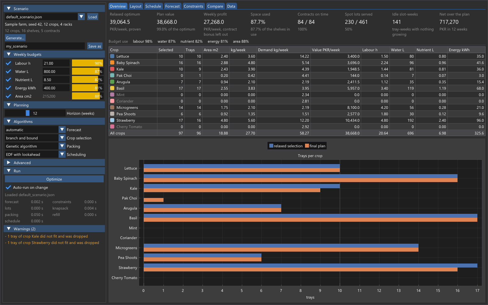
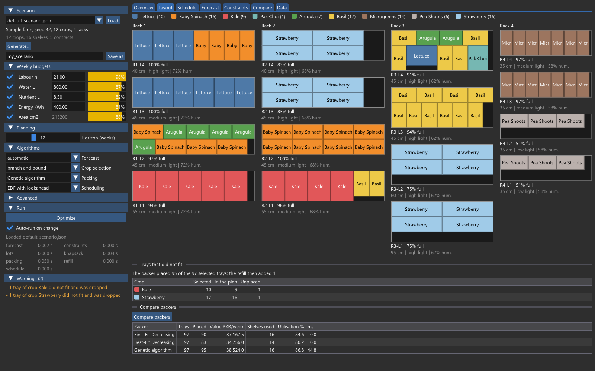

# Smart Vertical Farm

A planning tool for an indoor vertical farm, written in C++17 as a course project for Design and Analysis of Algorithms. Given a farm (crops, shelves, weekly budgets, delivery contracts, order history) it decides **what to plant, where every tray goes, and when to harvest and replant**. It shows the plan in a desktop app, prints it on the command line, and benchmarks each of its algorithms against the alternatives.





## What it does

One pipeline of five components. Each has several algorithms, so that they can be compared on the same farm:

| Question | Component | Algorithms |
|---|---|---|
| Which crops may stand on which shelves, and which may not share one? | Constraints | compatibility matrix and conflict graph; graph colouring by Welsh-Powell, DSATUR and exact backtracking |
| How much spot demand will each crop have? | Forecasting | seasonal naive, moving average, simple exponential smoothing, additive Holt-Winters; picked by hold-out error |
| How many trays of each crop, within the weekly budgets of labour, water, nutrient, energy and floor area? | Crop selection (a multi-dimensional knapsack) | greedy, dynamic programming, branch and bound |
| Where does each tray go? | Packing (rows on shelves, with conflicts) | First-Fit Decreasing, Best-Fit Decreasing, a genetic algorithm |
| When is each batch planted and harvested, so that contracts are met? | Scheduling | earliest deadline first, EDF with lookahead, an exact search; a slot-count search based on interval partitioning |

The sample farm is **generated** by a seeded generator (twelve crops, four racks, five contracts, prices in PKR, a Pakistani market). There is no real farm data. The model is deliberately small: one static layout plus a weekly timeline, no crop rotation, no stacking of trays. Section 2 of [the plan](plan/IMPLEMENTATION_PLAN.md) lists what is left out.

## Build and run (Windows)

You need a 64-bit Windows 10 or 11 and:

- **g++ (MinGW-w64), CMake and Ninja.** One package provides all three: `winget install -e --id BrechtSanders.WinLibs.POSIX.UCRT`. It was built and tested with GCC 16.2.0, CMake 4.4.4 and Ninja 1.13.2; CMake 3.24 or newer is required.
- **Git for Windows.** `build.ps1` borrows its certificate bundle, because the CMake in the WinLibs package has none and cannot verify the downloads otherwise.
- **Internet access for the first build.** CMake downloads the third-party sources into `.deps/` (about 20 MB unpacked). The first build takes about five minutes; `build/` and `.deps/` together take about 65 MB.
- For the desktop app, a graphics driver with **OpenGL 3.0**. The core, the command line and the tests need no graphics.

```powershell
git clone <repository-url>
cd <the cloned folder>            # the path may contain spaces
.\build.ps1 -Test                 # configure, build everything, run the tests
```

`build.ps1` rebuilds `PATH` from the registry (so a tool that winget has just installed is found), locates g++, and builds with CMake and Ninja in Release mode. `-Clean` deletes the build folder first, `-Config Debug` builds a debug version, `-BuildDir <dir>` builds somewhere else, `-Test` runs the tests afterwards.

The result is `farm_app.exe`, `farm_cli.exe` and `farm_tests.exe` in `build\`. They are linked statically and run on a machine without MinGW:

```powershell
.\build\farm_app.exe                                  # the desktop app
.\build\farm_app.exe --scenario data\flat_scenario.json --theme light
.\build\farm_cli.exe run --scenario data\default_scenario.json --packer ga
.\build\farm_cli.exe compare --scenario data\flat_scenario.json
.\build\farm_cli.exe generate --out my_farm.json --seed 7 --crops 8 --racks 3
.\build\farm_cli.exe validate --scenario my_farm.json
```

The command-line tool:

```text
usage: farm_cli <command> [options]
  generate --out FILE [--seed N] [--crops N] [--racks N] [--flat] [--jitter X] [--horizon N]
  validate --scenario FILE
  run --scenario FILE [--forecast auto|naive|ma|ses|hw] [--knapsack greedy|dp|bnb] [--packer ffd|bfd|ga]
      [--scheduler edf|lookahead|exact] [--lookahead N] [--no-refill] [--ga-seed N] [--out FILE]
  compare --scenario FILE [--out FILE]
  bench [--quick] [--suite NAME] [--out DIR] [--machine TEXT]
exit codes: 0 success, 1 failure while running, 2 bad arguments or invalid scenario
```

`run` prints the plan as text and, with `--out`, writes it as JSON. The results are deterministic: the same scenario and options give the same file, apart from a separate `timing` key. `compare` runs every algorithm of every stage on the same farm (the dynamic-programming solver takes a few seconds on the sample farm, which is the point of including it).

The desktop app has a sidebar (scenario, weekly budgets, horizon, the algorithm of each stage, an Optimize button) and seven tabs: Overview, Layout, Schedule, Forecast, Constraints, Compare (which also draws the benchmark curves) and Data. It looks for `data\` (and `bench\results\`, for the benchmark curves) in the current folder, beside the executable, or one level above it. Two more modes exist for checking it without a person: `farm_app --screenshot <folder>` writes a PNG of every tab, and `farm_app --selftest` runs a scripted session and exits with 0 on success.

**Other platforms.** The Windows-specific parts are `build.ps1`, a few `#ifdef _WIN32` lines in the app (the executable's folder and an error message box) and the MinGW options in `CMakeLists.txt`. On Linux or macOS the same `CMakeLists.txt` should work with GCC or Clang and the system's OpenGL and GLFW dependencies, but this has not been tried. To build only the core, the command line and the tests, which need no OpenGL, run `cmake -S . -B build -G Ninja -DFARM_BUILD_APP=OFF` and `cmake --build build`. (With the WinLibs package on Windows, add `-DCMAKE_TLS_CAINFO=<path of the ca-bundle.crt of Git for Windows>` to the first command, as `build.ps1` does; see the notes at the end.)

## Tests

`.\build.ps1 -Test` runs three CTest entries: `farm_tests` (unit tests, the golden numbers of Appendix A of the plan, and property tests that compare the algorithms with brute-force oracles), `farm_cli_run` (the command line on the flat sample farm must print the plan's relaxed optimum of 39486.5) and `farm_cli_bench` (a quick benchmark run). The golden numbers come from `plan/reference_model.py`, a Python script that is the executable definition of the plan's formulas. It is a checking tool only; the product is C++.

## Reproduce the benchmarks

`farm_cli bench` times every algorithm on ten suites (plan section 15) and writes one CSV file per suite plus `summary.md` into `bench\results\`. `summary.md` holds the median time and quality per size and the measured growth exponent of each algorithm; its first lines record the machine, compiler and flags. Run it from a Release build, with the computer on mains power and nothing else busy:

```powershell
.\build.ps1
$cpu = Get-CimInstance Win32_Processor | Select-Object -First 1
$sys = Get-CimInstance Win32_ComputerSystem
.\build\farm_cli.exe bench --machine "$($cpu.Name.Trim()), $($cpu.NumberOfCores) cores / $($cpu.NumberOfLogicalProcessors) threads, $([math]::Round($sys.TotalPhysicalMemory/1GB,1)) GB RAM"
```

The full run takes about a minute and a half and **overwrites the committed files** in `bench\results\`; add `--out <folder>` to write elsewhere. `--quick` runs the two smallest sizes with one seed in a few seconds, and `--suite <name>` re-runs one suite and keeps the others. The suites are `knap_1d`, `knap_dims`, `knap_farm`, `pack_tight`, `pack_loose`, `sched`, `sched_window`, `sched_exact`, `forecast` and `colouring`. Timings depend on the machine. The quality columns do not, unless branch and bound reaches its node or time limit, which it never did in the committed results.

The analysis of every algorithm, with the measured exponents set beside the theoretical bounds, is in [docs/complexity-analysis.md](docs/complexity-analysis.md).

## Report and slides

The report (Word) and the slides (PowerPoint) are generated by two scripts in `docs/tools/`. They run the built program, read the files it writes (`farm_cli run` and `compare` with `--out`, `farm_tests`, `farm_app --screenshot --theme light`, and `bench\results\`) and insert every number from them, so a number changes only when the program does. They stop with a message when a quoted sentence of the Seoul Accord is missing or a statement no longer matches the data. This is documentation tooling in Python; the product is C++ only.

```powershell
uv venv .venv-docs
uv pip install --python .venv-docs python-docx python-pptx
.\.venv-docs\Scripts\python docs\tools\build_report.py      # docs\report\Smart_Vertical_Farm_Report.docx
.\.venv-docs\Scripts\python docs\tools\build_slides.py      # docs\slides\Smart_Vertical_Farm_Slides.pptx
```

The title page names the team, and this repository is public, so the names are not in it: put them in `docs/tools/team.local.json`, which git ignores (the script prints the format when the file is missing). The two output files are ignored by git for the same reason. When Word is installed, `build_report.py` lets it build the table of contents; without Word, press F9 on the contents page. `audit_numbers.py <file>` lists the numbers of a finished report or deck that do not appear in any file the program wrote (derived values, constants of the code and citation years are among them), so each can be traced by hand.

## Project layout

```text
CMakeLists.txt        build definition; dependencies are fetched by CMake into .deps/
build.ps1             one-command build and test on Windows
data/                 default_scenario.json (the sample farm), flat_scenario.json (flat demand: the golden test's input)
src/core/             the algorithms and the data model: the C++ standard library only, except json_io.cpp
                      (the only file that includes nlohmann/json)
                        constraints, forecast, knapsack, packing, scheduling   the five components
                        pipeline                                               the whole plan in one call, and compareAll
                        generator, rng.h, json_io, model.h                     sample data, random numbers, files, structs
                        bench                                                  the benchmark suites and summary.md
src/cli/              farm_cli, the command-line tool
src/app/              farm_app, the Dear ImGui desktop app
tests/                farm_tests: a small hand-written CHECK harness, run by CTest
bench/results/        the ten CSV files and summary.md written by `farm_cli bench`
docs/                 complexity-analysis.md; screenshots/ (the PNG files that `farm_app --screenshot` writes);
                      tools/ (the generators of the report and the slides; report/ and slides/ hold their output, ignored by git)
plan/                 the implementation plan, and reference_model.py
```

## Every algorithm is hand-written

All algorithms listed above, and the random-number generator (SplitMix64 in `src/core/rng.h`, so that a seed gives the same result on every machine), are written in this project. The code in `src/core` uses only the C++ standard library. The third-party libraries below draw the window and the charts, read and write JSON and save PNG files; none of them contains an algorithm of this project.

The product is C++ only. Python is used only as tooling: `plan/reference_model.py` checks the plan's golden numbers, and the generators of the report and the slides (in `docs/tools/`, see "Report and slides") are documentation tooling.

## Third-party code

CMake downloads these at pinned versions into `.deps/` (nothing is copied into this repository), and links them into the executables. Each library's licence text is in its folder under `.deps/` after the first build.

| Library | Version | Used for | Licence |
|---|---|---|---|
| [Dear ImGui](https://github.com/ocornut/imgui) | 1.93.0 | the user interface | MIT |
| [ImPlot](https://github.com/epezent/implot) | 1.1 | the charts | MIT |
| [GLFW](https://github.com/glfw/glfw) | 3.5.1 | the window and the OpenGL context | zlib |
| [nlohmann/json](https://github.com/nlohmann/json) | 3.12.0 | reading and writing scenario and result files | MIT |
| [stb_image_write](https://github.com/nothings/stb) | 1.16 | saving PNG screenshots | MIT or public domain, at your choice |

## Licence

This project is released under the [MIT licence](LICENSE). The libraries in the table above keep their own licences.

## Notes on this build

- **Toolchain location.** The plan asked for the toolchain on drive D:. This computer has no D: drive, so the WinLibs package that winget installed under `%LOCALAPPDATA%\Microsoft\WinGet\Packages` on C: is used (the plan's first fallback: accept C: while it keeps 4 GB free).
- **Certificates.** The CMake in the WinLibs package has no list of certificate authorities, so `build.ps1` passes `-DCMAKE_TLS_CAINFO` pointing at the bundle of Git for Windows.
- **No other fallback was needed.** GLFW 3.5.1, Dear ImGui 1.93.0 and ImPlot 1.1 built as pinned, and the OpenGL context opened.
- **What has been checked.** The tests and benchmarks ran on one Windows 11 computer with GCC 16.2.0. Every tab of the app was checked through its screenshot and its numbers against `farm_cli run`, and `--selftest` passes. The project owner has also clicked through the app by hand and found nothing wrong. Display scaling above 100% has not been tried.
